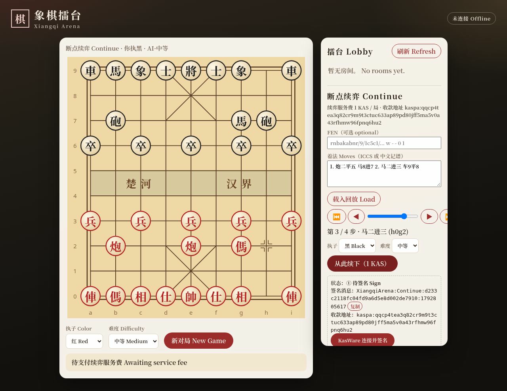

# 象棋擂台 Xiangqi Arena

**▶ 在线演示 Live demo: https://chess.kastop.com**



进程内中国象棋规则、alpha-beta 引擎，以及带棋盘页面的对局服务器。**免费人机房间保存在内存里，进程退出后清空；付费「断点续弈」会话存于 SQLite，重启后仍在。**

In-process Xiangqi rules, an alpha-beta engine, and a game server with a board page. **Free vs-AI rooms stay in memory and disappear when the process exits; paid 断点续弈 (continue-from-position) sessions are stored in SQLite and survive restarts.**

服务器默认监听 `http://0.0.0.0:5080`。本机浏览或 curl 用 `http://127.0.0.1:5080`。

The server listens on `http://0.0.0.0:5080`. Browse and curl it at `http://127.0.0.1:5080`.

## 功能 Features

- 规则引擎：将帅、仕士、相象、马、车、炮、兵卒，整将、宫心、塞象眼、马腿、炮架。困毙与将死都判负。同一局面（棋子与行棋方）三次重复，或 120 步无吃子，判和。
- Rules for generals, advisors, elephants, horses, chariots, cannons, and soldiers, including flying generals, palace, elephant-eye, horse-leg, and cannon-screen. Stalemate and checkmate both lose. The same piece placement and side to move repeated three times is a draw, as are 120 plies with no capture.
- 内置 `AlphaBetaEngine`：`easy` 深度 2，`medium` 深度 4，`hard` 深度 6 且最多约 5 秒。
- Builtin `AlphaBetaEngine`: `easy` depth 2, `medium` depth 4, `hard` depth 6 with about a 5 second cap.
- 擂台：多房间。座位可以是人、内置 AI，或持令牌的外部 Bot。轮到 AI 时，服务器在后台搜索并落子，再向该房间的 SignalR 组广播 `state`。
- Arena of rooms. A seat is a human, the builtin AI, or a token-authenticated external bot. On an AI turn the server searches in the background, plays the move, and broadcasts `state` to that room's SignalR group.
- 网页棋盘：楚河汉界、九宫斜线、红方 帥仕相傌俥炮兵、黑方 將士象馬車砲卒。点击走子、合法点高亮、上一着高亮、将军与终局提示。可新开人机对局，也可刷新擂台列表后观战。
- Web board: river (楚河 汉界), palace diagonals, red 帥仕相傌俥炮兵 and black 將士象馬車砲卒. Click to move, legal-move dots, last-move highlight, check and game-over messages. Start a game against the AI, or refresh the lobby and spectate.

## 断点续弈 Continue from a position

导入 FEN 或着法（ICCS 如 `h2e2`，或中文记谱如 `炮二平五`、`前车进一`；红方数字从右往左用中文数字，黑方用阿拉伯数字），在回放里用 ◀ ▶ / 滑块选择断点，选执子与难度后点击「从此续下（1 KAS）」，再与内置 AI 继续对弈。每个续弈会话收取一次 **续弈服务费 1 KAS**（Kaspa）。

Import a FEN or a move list (ICCS like `h2e2`, or Chinese notation like `炮二平五`, `前车进一`; Red counts files right-to-left in Chinese numerals, Black uses digits), pick a breakpoint with ◀ ▶ / the slider, choose side and difficulty, press 「从此续下（1 KAS）」 and play on against the built-in AI. Each session costs one **续弈服务费 (continuation service fee) of 1 KAS** (Kaspa).

官方收款地址 Official pay address (mainnet):

```
kaspa:qqcp4tea3q82cr9m9t3ctuc633ap89pd80jff5ma5v0a43rfhmw96fpnq6hu2
```

### 流程 Flow

1. `POST /api/continue/sessions` 创建会话（`pending_auth`），返回要签名的消息 `XiangqiArena:Continue:{sessionId}:{timestamp}` 与会话令牌。Create a session; you get the message to sign and a session token.
2. 用 KasWare（`requestAccounts` + `signMessage`，Schnorr）签名，或手动粘贴地址与签名，`POST …/auth`。Sign with KasWare or paste address + signature manually.
3. 支付 1 KAS 到收款地址（KasWare `sendKaspa`，或任意钱包，**须从签名地址发出**），`POST …/payment` 提交 txid。Pay 1 KAS from the signed address and submit the txid.
4. 服务器验证后会话变为 `active`，`POST …/moves` 走子（支持 ICCS 与中文记谱），AI 同步应着。Once verified the session is `active`; play via `…/moves`.

### 服务器端验证 Server-side verification

- 签名：Kaspa personal message（BLAKE2b-256，key `PersonalMessageSigningHash`）上的 BIP340 Schnorr，公钥取自 `kaspa:` 版本 0 地址的 32 字节负载；时间戳须在 10 分钟内。Kaspa personal-message Schnorr signature, timestamp must be fresh (10 min).
- 付款：通过 Kaspa REST（默认 `https://api.kaspa.org`）读取交易：`is_accepted`、确认数（默认 ≥ 10）、有输出给 `PayToAddress` 且 ≥ 100000000 sompi、输入来自已签名地址。Payment is read from the Kaspa REST API: accepted, ≥ 10 confirmations, an output of ≥ 1 KAS to the pay-to address, inputs from the signed address.
- 防重放：txid 全局唯一（SQLite `UNIQUE` + `used_txids`，同事务写入）。Each txid can be used once, ever.
- 仅支持 Schnorr 地址（`kaspa:q…`）。ECDSA / Tangem 地址不支持。Only Schnorr (`kaspa:q…`) addresses are supported; ECDSA / Tangem are not.
- 未付费时 `POST …/moves` 返回 **402**；未配置收款地址时 auth/payment 返回 **503**，页面显示「未开放」。Unpaid moves return 402; without a pay-to address, auth/payment return 503 and the UI shows it as unavailable.

### 配置 Configuration

| 键 Key | 默认 Default | 说明 Meaning |
| --- | --- | --- |
| `Payment:PayToAddress` | `""` | 收款地址；为空即关闭付费功能。Pay-to address; empty disables the feature. |
| `Payment:Network` | `mainnet` | `mainnet` 或 `testnet-10`。 |
| `Payment:ApiBaseUrl` | `https://api.kaspa.org` | Kaspa REST。 |
| `Payment:PriceSompi` | `100000000` | 1 KAS。 |
| `Payment:MinConfirmations` | `10` | 最少确认数。Minimum confirmations. |
| `Payment:TestMode` | `false` | **仅开发**：跳过链上校验。Development only; refuses to start in Production. |
| `Storage:DbPath` | `App_Data/xiangqi.db` | SQLite 路径。 |

环境变量写法 Env style: `Payment__PayToAddress=kaspa:...`。生产环境建议放在 `appsettings.Production.json`。

### 续弈 API Continue API

| 方法 Method | 路径 Path | 说明 |
| --- | --- | --- |
| GET | `/api/continue/config` | 是否开放、收款地址、金额。 |
| POST | `/api/continue/parse` | `{fen?, moves}` → 起始 FEN、ICCS、中文、每步 FEN。Replay data. |
| POST | `/api/continue/sessions` | `{fen?, moves?, ply?, difficulty, humanColor}` 创建会话。 |
| GET | `/api/continue/sessions/{id}` | 会话与局面。 |
| POST | `/api/continue/sessions/{id}/auth` | `{token, address, signature, timestamp}`。 |
| POST | `/api/continue/sessions/{id}/payment` | `{token, txid}`；确认数不足返回 202，可稍后重试。 |
| POST | `/api/continue/sessions/{id}/moves` | `{token, move}`；未付费 402。 |

```bash
B=https://chess.kastop.com
curl -s $B/api/continue/sessions -H 'Content-Type: application/json' \
  -d '{"moves":"炮二平五 马8进7","difficulty":"easy","humanColor":"red"}'
# -> { "id": "...", "token": "...", "message": "XiangqiArena:Continue:<id>:<ts>", "payToAddress": "kaspa:qqcp…", ... }
curl -s -o /dev/null -w '%{http_code}\n' $B/api/continue/sessions/<id>/moves \
  -H 'Content-Type: application/json' -d '{"token":"<token>","move":"h2e2"}'   # 402 until paid
```

### 未验证项 Not verified against real hardware

签名算法已用 rusty-kaspa 官方测试向量验证；但**尚未用真实 KasWare 签名端到端验证**，也未做过真实 1 KAS 链上支付。The signature code is checked against rusty-kaspa test vectors, but not yet end-to-end with a real KasWare signature or a real 1 KAS payment.

## 架构 Architecture

```
Browser / external bot
    |  REST JSON (camelCase)          SignalR /hub/game  event "state"
    v                                 ^
Xiangqi.Server  ArenaService  -------+
    |  ConcurrentDictionary + per-room lock
    |  AI turn -> AlphaBetaEngine (IEngine) on a background task
    v
Xiangqi.Core   Board, Move, Game, ChineseNotation, GameRecord
Xiangqi.Engine IEngine, AlphaBetaEngine, UciEngine (Pikafish-shaped, not spawned)
```

| 项目 Project | 职责 Role |
| --- | --- |
| `src/Xiangqi.Core` | 棋盘、走法、对局状态与和棋/胜负。Board, moves, game status. |
| `src/Xiangqi.Engine` | `IEngine`、`AlphaBetaEngine`、面向 Pikafish 的 `UciEngine`。 |
| `src/Xiangqi.Server` | 擂台、REST、SignalR、`wwwroot` 页面。Arena, REST, SignalR, static UI. |
| `tests/Xiangqi.Tests` | 规则、perft、引擎，以及 API 冒烟测试。Rules, perft, engine, API smoke tests. |

走法记谱从红方视角：文件 `a`–`i` 从左到右，横线 `0`–`9` 从红方底线数起。`h2e2` 是红炮平五。棋盘数组 `board[0]` 是上方（黑方底线，横线 9），`board[9]` 是红方底线。格子是 FEN 字母，空格为 `""`。

Move text is from Red's point of view: files `a`–`i` left to right, ranks `0`–`9` up from Red's back rank. `h2e2` slides the red cannon on h2 to e2. `board[0]` is the top rank (Black's back rank, rank 9) and `board[9]` is Red's back rank. Cells are FEN letters, or `""` when empty.

| FEN | 红 Red | 黑 Black | 棋子 Piece |
| --- | --- | --- | --- |
| `K` / `k` | 帥 | 將 | 将 General |
| `A` / `a` | 仕 | 士 | 士 Advisor |
| `B` / `b` | 相 | 象 | 象 Elephant |
| `N` / `n` | 傌 | 馬 | 马 Horse |
| `R` / `r` | 俥 | 車 | 车 Chariot |
| `C` / `c` | 炮 | 砲 | 炮 Cannon |
| `P` / `p` | 兵 | 卒 | 兵 Soldier |

## 运行 Run

```bash
dotnet run --project src/Xiangqi.Server
```

打开 Open `http://127.0.0.1:5080`.

`dotnet run` 使用 `src/Xiangqi.Server/Properties/launchSettings.json` 里的 `http://0.0.0.0:5080`。直接运行 dll 且没有设置 `ASPNETCORE_URLS` / `ASPNETCORE_HTTP_PORTS` 时，程序同样监听该地址。

`dotnet run` uses `http://0.0.0.0:5080` from `launchSettings.json`. Running the dll with neither `ASPNETCORE_URLS` nor `ASPNETCORE_HTTP_PORTS` listens on that address too.

## 观战、连接与托管 Spectating, the client, and hosting

人机房间默认是私有的：`isPublic` 为 false，不会出现在 `GET /api/rooms` 擂台列表里。新对局里的「可观战 Allow spectators」复选框默认不勾选；勾选后请求体带 `spectate: true`（`VsAiRequest.Spectate`），房间才会列入擂台，房间名称仍是「人机 · 执红/黑 · 难度」。无论是否公开，`GET /api/rooms/{id}` 都能打开该局，响应里只有人类座位的令牌，不会带出 AI 座位令牌。

Vs-AI rooms are private by default (`isPublic: false`) and are omitted from `GET /api/rooms`. The new-game checkbox 「可观战 / Allow spectators」 is unchecked until the player opts in; the client then sends `spectate: true` (`VsAiRequest.Spectate`) and the room is listed under the same name (`人机 · 执红/黑 · 难度`). `GET /api/rooms/{id}` works either way. The create response includes only the human seat token and never the AI seat token.

网页的 SignalR 客户端和字体都是自托管的：脚本在 `wwwroot/lib/signalr.min.js`，字体是系统字体栈。内容安全策略只允许 `'self'`。脚本加载失败时改为每秒轮询 `GET /api/rooms/{id}`。

The SignalR client and fonts are self-hosted (`wwwroot/lib/signalr.min.js`, the system font stack). Content-Security-Policy is `'self'` only. If that script fails to start a hub connection, the page polls `GET /api/rooms/{id}` once a second.

`runtimeconfig` 使用工作站、非并发 GC（`ServerGarbageCollection=false`，`ConcurrentGarbageCollection=false`），适合小主机。堆上限可用环境变量 `DOTNET_GCHeapHardLimit` 或 `System.GC.HeapHardLimit` 设置，工程本身不写死上限。

The runtimeconfig uses workstation non-concurrent GC (`ServerGarbageCollection=false`, `ConcurrentGarbageCollection=false`) for small hosts. Cap the heap with `DOTNET_GCHeapHardLimit` or `System.GC.HeapHardLimit`; this project does not set a limit itself.

悔棋只在人机对局仍在进行时可用（AI 思考中返回 409，对局结束或没有可退的着法返回 400）。`POST /api/rooms/{id}/join` 只能把空位加入为 `human` 或 `bot`。

Undo is available only while a vs-AI game is ongoing (409 while the AI is thinking, 400 when the game is over or nothing can be undone). Joining a seat via `/join` is only for `human` or `bot`.

## 测试 Test

```bash
dotnet test
```

冒烟测试会创建人机局（`easy`），读取合法着法，走一步，等待内置引擎应答，再确认非法着法返回 400。

The smoke test creates an easy vs-AI game, reads legal moves, plays one, waits for the builtin engine, and checks that an illegal move returns 400.

## Docker

```bash
docker build -t xiangqi .
docker run --rm -p 5080:5080 xiangqi
```

多阶段镜像：`sdk:8.0` 编译，`aspnet:8.0` 运行，暴露 5080。镜像里的默认 8080 端口已清空，改为 `ASPNETCORE_URLS=http://0.0.0.0:5080`。

Multi-stage image: build with `sdk:8.0`, run with `aspnet:8.0`, expose 5080. The image's default port 8080 is cleared in favor of `ASPNETCORE_URLS=http://0.0.0.0:5080`.

## CI

`.github/workflows/ci.yml` 在 `ubuntu-latest` 上安装 .NET `8.0.x`，然后 `dotnet restore`、`dotnet build`、`dotnet test`。

`.github/workflows/ci.yml` runs on `ubuntu-latest`, installs the .NET `8.0.x` SDK, then restores, builds, and tests the solution.

## HTTP API

JSON，属性名 camelCase。错误体为 `{ "error": "..." }`。

JSON, camelCase property names. Errors are `{ "error": "..." }`.

| 状态 Status | 含义 Meaning |
| --- | --- |
| 400 | 请求不合法、着法格式错误、非法着法，或对局已结束。Bad body, bad move text, illegal move, or the game is over. |
| 403 | 令牌不是行棋方。The token does not own the side to move. |
| 404 | 没有这个房间。Unknown room. |
| 409 | 座位已被占用。Seat is taken. |

座位种类 Seat kinds：`human`、`ai`（别名 alias `builtin`、`builtinAi`）、`bot`（别名 `external`、`externalBot`）。创建房间时还可以用 `open`（别名 `empty`、`none`）留出空位。加入时 `kind` 只能是 `human` 或 `bot`。难度 `easy`、`medium`、`hard`，省略时为 `medium`。

`open` (aliases `empty`, `none`) leaves a seat empty on create. Join accepts only `human` or `bot`. Difficulty defaults to `medium`.

人与 Bot 座位会得到令牌。AI 与空位没有令牌。令牌是不透明字符串，请当作秘密保存；`GET` 不会再次返回。

Human and bot seats receive a token. AI and open seats do not. Tokens are opaque secrets and are not returned again by `GET`.

### `GET /api/health`

```bash
curl -s http://127.0.0.1:5080/api/health
```

```json
{ "status": "ok" }
```

### `POST /api/rooms`

创建房间。响应包含房间、当前局面，以及人/Bot 座位的令牌。

Creates a room. The response has the room, the position, and tokens for human and bot seats.

```bash
curl -s http://127.0.0.1:5080/api/rooms \
  -H 'Content-Type: application/json' \
  -d '{"name":"友谊赛","redKind":"human","blackKind":"bot","difficulty":"medium"}'
```

```json
{
  "id": "7d1c0c3e-1b4a-4e0a-9c2e-6f0a9b1c2d3e",
  "name": "友谊赛",
  "tokens": { "red": "a1b2…", "black": "c3d4…" },
  "state": { }
}
```

`name` 可省略，服务器会生成 `擂台` 加短 id。两个座位都可以是 `ai`，开局后红方 AI 会自动走子。

`name` is optional (`擂台` plus a short id). Both seats may be `ai`; Red's AI then moves on its own.

### `POST /api/games/vs-ai`

人机快捷入口。`humanColor` 为 `red` 或 `black`。另一方是内置 AI。若人执黑，红方 AI 会立刻在后台走第一步。

Convenience vs-AI game. `humanColor` is `red` or `black`. The other seat is the builtin AI. If the human takes Black, Red's AI starts thinking immediately.

```bash
curl -s http://127.0.0.1:5080/api/games/vs-ai \
  -H 'Content-Type: application/json' \
  -d '{"humanColor":"red","difficulty":"easy"}'
```

```json
{ "roomId": "7d1c…", "token": "a1b2…", "state": { } }
```

### `GET /api/rooms`

擂台列表。Lobby / arena list.

```bash
curl -s http://127.0.0.1:5080/api/rooms
```

```json
[
  {
    "id": "7d1c…",
    "name": "人机 · 执红 · 简单",
    "status": "ongoing",
    "sideToMove": "red",
    "moveCount": 0,
    "seats": {
      "red": { "kind": "human", "occupied": true, "difficulty": null },
      "black": { "kind": "ai", "occupied": true, "difficulty": "easy" }
    }
  }
]
```

`status`：`ongoing`、`redWins`、`blackWins`、`draw`。

### `GET /api/rooms/{id}`

完整局面。Full state.

```bash
curl -s http://127.0.0.1:5080/api/rooms/7d1c0c3e-1b4a-4e0a-9c2e-6f0a9b1c2d3e
```

```json
{
  "id": "7d1c…",
  "name": "人机 · 执红 · 简单",
  "fen": "rnbakabnr/9/1c5c1/p1p1p1p1p/9/9/P1P1P1P1P/1C5C1/9/RNBAKABNR w - - 0 1",
  "board": [
    ["r", "n", "b", "a", "k", "a", "b", "n", "r"],
    ["", "", "", "", "", "", "", "", ""],
    ["", "c", "", "", "", "", "", "c", ""],
    ["p", "", "p", "", "p", "", "p", "", "p"],
    ["", "", "", "", "", "", "", "", ""],
    ["", "", "", "", "", "", "", "", ""],
    ["P", "", "P", "", "P", "", "P", "", "P"],
    ["", "C", "", "", "", "", "", "C", ""],
    ["", "", "", "", "", "", "", "", ""],
    ["R", "N", "B", "A", "K", "A", "B", "N", "R"]
  ],
  "sideToMove": "red",
  "status": "ongoing",
  "inCheck": false,
  "lastMove": null,
  "history": [],
  "seats": {
    "red": { "kind": "human", "occupied": true, "difficulty": null },
    "black": { "kind": "ai", "occupied": true, "difficulty": "easy" }
  }
}
```

`inCheck` 表示行棋方是否被将军。`history` 与 `lastMove` 使用 `h2e2` 这种记谱。

`inCheck` is whether the side to move is in check. `history` and `lastMove` use notation such as `h2e2`.

### `GET /api/rooms/{id}/moves`

当前合法着法。对局结束时为空数组。

Legal moves for the side to move. An empty array when the game is over.

```bash
curl -s http://127.0.0.1:5080/api/rooms/7d1c0c3e-1b4a-4e0a-9c2e-6f0a9b1c2d3e/moves
```

```json
["a0a1", "a3a4", "b0a2", "b2e2", "h2e2"]
```

实际顺序以生成器为准。The generator's order is the order you get.

### `POST /api/rooms/{id}/moves`

令牌必须属于当前行棋方。成功时返回走子之后的局面（AI 的应着随后经 SignalR 或下一次 `GET` 出现）。

The token must belong to the side to move. Success returns the position after this move. An AI reply follows on SignalR, or on the next `GET`.

```bash
curl -s http://127.0.0.1:5080/api/rooms/7d1c0c3e-1b4a-4e0a-9c2e-6f0a9b1c2d3e/moves \
  -H 'Content-Type: application/json' \
  -d '{"move":"h2e2","token":"a1b2c3d4e5f64789a0b1c2d3e4f56789"}'
```

非法着法：

```bash
curl -s -o /dev/null -w '%{http_code}\n' \
  http://127.0.0.1:5080/api/rooms/7d1c0c3e-1b4a-4e0a-9c2e-6f0a9b1c2d3e/moves \
  -H 'Content-Type: application/json' \
  -d '{"move":"a0a0","token":"YOUR_TOKEN"}'
```

打印 `400`。Prints `400`.

### `POST /api/rooms/{id}/join`

空座位加入为 `human` 或 `bot`，返回新令牌。

Take an open seat as `human` or `bot` and receive a token.

```bash
curl -s http://127.0.0.1:5080/api/rooms/7d1c0c3e-1b4a-4e0a-9c2e-6f0a9b1c2d3e/join \
  -H 'Content-Type: application/json' \
  -d '{"color":"black","kind":"bot"}'
```

```json
{ "token": "c3d4…", "color": "black", "state": { } }
```

### `POST /api/rooms/{id}/resign` 与 `/undo`

body `{ "token": "..." }`。`resign`：持有任一座位令牌的一方认输，返回最新 `state`。`undo`：仅人机房间，退回到你再次行棋的局面（若 AI 正在思考返回 `409`，无可退返回 `400`）。错误信息为「中文 / English」。

Body `{ "token": "..." }`. `resign`: the holder of either seat's token resigns and gets the new `state`. `undo`: human-vs-built-in-AI rooms only; rewinds to your next turn (`409` while the AI is thinking, `400` when nothing can be undone). Error messages are "中文 / English".

### 擂台配置 Arena configuration

| 键 Key | 默认 Default | 说明 Meaning |
| --- | --- | --- |
| `Arena:MaxRooms` | `300` | 房间上限，满了返回 503。Room cap; 503 when full. |
| `Arena:AllowAiVsAi` | `false` | 是否允许 AI 对 AI 房间。Allow AI-vs-AI rooms. |
| `Arena:RoomIdleMinutes` / `FinishedRoomMinutes` | `60` / `10` | 空闲或已结束房间的清理时间。Idle / finished room expiry. |
| `Arena:CreatePerMinute` / `ActionPerMinute` | `20` / `240` | 每 IP 每分钟创建房间 / 走子加入认输悔棋次数，`0` 关闭。Per-IP limits; `0` disables. |
| `Cors:AllowedOrigins` / `Cors:AllowAnyOrigin` | `[]` / `false` | 见上。See above. |
| `Forwarded:KnownProxies` / `KnownNetworks` | `[]` | 仅当列出反向代理时才信任 `X-Forwarded-*`；默认直连，不信任。Trust `X-Forwarded-*` only from listed proxies; default is direct, untrusted. |
| `Payment:ExpiredPaymentGraceMinutes` | `1440` | 会话过期后仍可提交已完成的付款的宽限期（验证规则不变）。Grace window after a session expires in which an already-made payment can still be submitted (verification rules unchanged). |

超过限速返回 `429`，带 `Retry-After` 和中英文 JSON。`Retry-After` 与正文里的秒数相同，是当前一分钟窗口还剩多少秒（最少 1，最多 60），不是固定的 60。没有匹配到的 `/api` 路径返回 404 JSON「接口不存在 / Not found.」；方法不被允许时返回 405 JSON「不支持的请求方法 / Method not allowed.」，并保留 `Allow` 头。接口自己已经写出的正文（例如未知房间的 404）不会被替换。

Rate-limited calls return `429` with `Retry-After` and a bilingual JSON error. `Retry-After` matches the seconds in the body: the time left in the current one-minute window (at least 1, at most 60), not a fixed 60. An unknown `/api` path returns 404 JSON "接口不存在 / Not found." A method the route does not allow returns 405 JSON "不支持的请求方法 / Method not allowed." and keeps the `Allow` header. A body the handler already wrote (for example the unknown-room 404) is left unchanged.

公共大厅：已结束的房间在结束 30 秒后从 `GET /api/rooms` 消失（`Arena:FinishedLobbyGraceSeconds`，默认 30），`GET /api/rooms/{id}` 仍可查看。观战时页面有「离开观战 Leave spectating」按钮。`Csp:ConnectSrcExtra`（可选，空格分隔）可在 CSP `connect-src` 里追加来源；`connect-src` 默认由请求的主机名生成。

Lobby: a finished room leaves `GET /api/rooms` 30 seconds after it ends (`Arena:FinishedLobbyGraceSeconds`, default 30); `GET /api/rooms/{id}` still works. While spectating, the page shows a "离开观战 Leave spectating" button. Optional `Csp:ConnectSrcExtra` (space separated) appends sources to the CSP `connect-src`, which is otherwise derived from the request host.

## 外部 Bot 协议 External bot protocol

1. 创建带 `bot` 座位的房间，或对空位 `POST /join`，`kind` 为 `bot`。保存返回的令牌，它只代表那一方。
   Create a room with a `bot` seat, or `POST /join` an open seat with `kind` `bot`. Keep the token. It authorizes only that seat.
2. 连接 SignalR `/hub/game`，调用 `JoinRoom(roomId)`，监听事件 `state`。事件体与 `GET /api/rooms/{id}` 相同。打不开 SignalR 时轮询该 GET。
   Connect to the SignalR hub at `/hub/game`, invoke `JoinRoom(roomId)`, and listen for `state`. The payload matches `GET /api/rooms/{id}`. Poll that GET if the hub is unreachable.
3. 当 `status` 为 `ongoing` 且 `sideToMove` 是你的颜色时，`GET .../moves`，选一个着法，再 `POST .../moves`，body 为 `{ "move": "h2e2", "token": "..." }`。
   When `status` is `ongoing` and `sideToMove` is your color, `GET .../moves`, choose one, and `POST .../moves` with `{ "move": "h2e2", "token": "..." }`.
4. `400` 表示着法非法或对局已结束，`403` 表示还没轮到这个令牌，`404` 表示房间不存在。不要替 `ai` 座位走子，服务器会自己走。
   `400` means illegal or the game is over, `403` means it is not this token's turn, `404` means the room is gone. Do not move for an `ai` seat; the server plays those turns.

浏览器里的跨源调用默认只允许本机（localhost）和 `Cors:AllowedOrigins` 里列出的来源，无凭据；`Cors:AllowAnyOrigin=true` 可重新放开（不建议公网使用）。令牌放在 JSON 里，不要放在 URL 上。`/hub/game`（negotiate 和 WebSocket）如果带了 `Origin`，只接受同源、本机开发来源，或与上面同一份允许列表；不允许时返回 403 JSON「来源不被允许 / Origin not allowed.」。没有 `Origin` 的非浏览器客户端可以连接。

Cross-origin browser calls are allowed only from localhost and the origins listed in `Cors:AllowedOrigins` (no credentials); `Cors:AllowAnyOrigin=true` re-opens it (not recommended on the public internet). Send the token in JSON, not in the URL. Non-browser bots are not affected by CORS. `/hub/game` (negotiate and the WebSocket) accepts an `Origin` only when it is same-origin, a local dev origin, or on that same allowlist; otherwise it returns 403 JSON "来源不被允许 / Origin not allowed." Clients that omit `Origin` may connect.

```javascript
const connection = new signalR.HubConnectionBuilder()
  .withUrl("http://127.0.0.1:5080/hub/game")
  .withAutomaticReconnect()
  .build();
connection.on("state", (state) => console.log(state.fen, state.sideToMove));
await connection.start();
await connection.invoke("JoinRoom", roomId);
```

## 外部 Bot 示例 / curl walkthrough

C# 控制台示例：`examples/ExternalBot`（用令牌加入座位，仅通过 HTTP 对弈）。
A C# console example lives in `examples/ExternalBot` (join a seat with a token, play over HTTP only).

```bash
# 1. 创建房间，黑方留空 Create a room with an open black seat
curl -s http://127.0.0.1:5080/api/rooms -H 'Content-Type: application/json' \
  -d '{"redKind":"human","blackKind":"open"}'          # -> id, tokens.red
# 2. 运行 Bot 加入黑方 Run the bot (joins black)
dotnet run --project examples/ExternalBot -- http://127.0.0.1:5080 <roomId> black
# 3. 红方走子 Move for Red with the red token
curl -s http://127.0.0.1:5080/api/rooms/<roomId>/moves -H 'Content-Type: application/json' \
  -d '{"move":"h2e2","token":"<red token>"}'
# 4. 观察局面 Watch the state
curl -s http://127.0.0.1:5080/api/rooms/<roomId>
```

## IEngine 与 Pikafish 计划 IEngine and Pikafish

`Xiangqi.Engine.IEngine` 是唯一的搜索入口：

`Xiangqi.Engine.IEngine` is the only search entry point:

```csharp
Task<EngineResult> SearchAsync(Board board, SearchLimits limits, CancellationToken cancellationToken);
```

- 今天，座位 `ai` 固定使用进程内的 `AlphaBetaEngine`。`ArenaService` 在房间锁之外克隆棋盘并调用 `SearchAsync`，回到锁内确认仍是该方行棋且着法合法，然后 `Game.MakeMove`，再广播 `state`。难度来自 `SearchLimits.For(Difficulty)`。
- Today an `ai` seat always uses the in-process `AlphaBetaEngine`. `ArenaService` clones the board outside the room lock, calls `SearchAsync`, then under the lock checks that it is still that side's turn and the move is legal, calls `Game.MakeMove`, and broadcasts `state`. Difficulty comes from `SearchLimits.For`.
- `UciEngine` 已经按 Pikafish 的 UCI 写好：启动进程，`uci` / `uciok`，`isready` / `readyok`，`position fen`，`go depth` 与 `go movetime`，解析 `bestmove`。它实现同一个 `IEngine`，所以换成强引擎不必改 REST 或 `state` 事件。
- `UciEngine` already speaks the UCI subset Pikafish uses: spawn the process, `uci` / `uciok`, `isready` / `readyok`, `position fen`, `go depth` and `go movetime`, parse `bestmove`. It is an `IEngine`, so a stronger engine does not change REST or the `state` event.
- 下一步：增加配置 `Engines:Pikafish:Path`（以及可选参数）。`ArenaService` 按房间选择 `UciEngine` 或 `AlphaBetaEngine`。每个 UCI 进程同时只能有一路搜索，因此用每房间一个进程，或一个小进程池，并在房间关闭时 `Dispose`。服务器现在不启动 Pikafish，部署也不依赖那个二进制文件。
- Next: configuration `Engines:Pikafish:Path` plus optional arguments. `ArenaService` picks `UciEngine` or `AlphaBetaEngine` per room. One UCI process searches one position at a time, so use one process per room or a small pool, and `Dispose` it when the room goes away. The server does not launch Pikafish today and does not need that binary to build or run.
